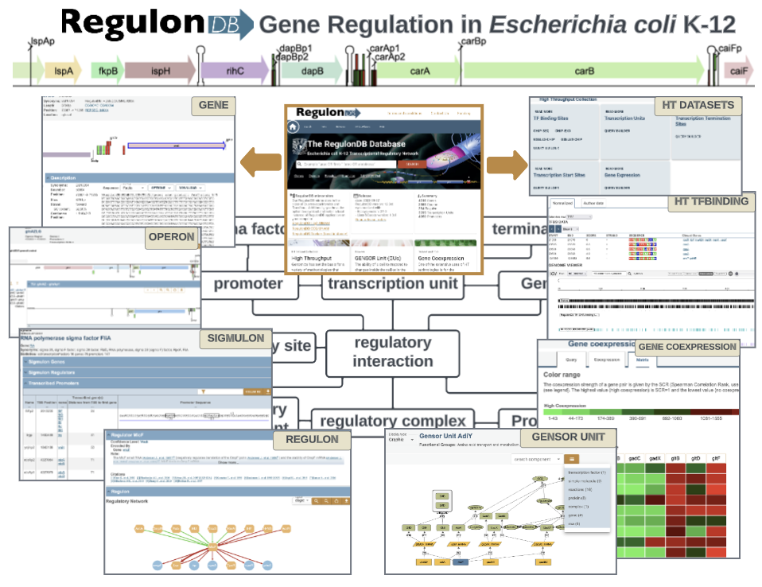

# What is RegulonDB?

**RegulonDB** is a comprehensive and expertly curated knowledge base dedicated to the **transcriptional regulatory network of *Escherichia coli* K-12**, a model organism in molecular biology and systems biology. It has been developed and maintained by the *Program of Computational Genomics* at the **Centro de Ciencias Genómicas (UNAM)** for over 25 years (since 1998).

The current release is **RegulonDB v14.5.1** (November 11, 2026). The most recent reference publication is **RegulonDB v12.0** (Salgado *et al.*, *Nucleic Acids Research*, 2024; [doi:10.1093/nar/gkad1072](https://doi.org/10.1093/nar/gkad1072)). See [How to Cite RegulonDB](how_to_cite.md).

 

## Purpose and Mission

RegulonDB provides a **gold-standard reference** of experimentally supported regulatory elements in ***E. coli***, serving as a reliable resource for:

- Understanding the architecture of bacterial gene regulation
- Supporting the development and validation of computational models
- Enabling reproducible and interoperable analyses in genomics

Its **mission is to organize and disseminate high-quality regulatory knowledge** in a structured, computable format that meets the needs of both experimental and computational researchers.

 

## Resource Type

In terms of the Global Core Biodata Resource (GCBR) criteria, RegulonDB is:

- **Knowledge base: YES.** RegulonDB is an expert-curated knowledge base. Its content is extracted, interpreted, and integrated by biocurators from peer-reviewed literature and selected high-throughput datasets.
- **Deposition database: NO.** RegulonDB is not a public submission repository for primary data. Datasets and contributions from collaborators are incorporated only after expert curation.

 

## What It Contains

RegulonDB integrates detailed information on:

- **Genes, operons, transcription units and regulons**, organized into functional transcriptional modules

- **Promoters and transcription start sites (TSSs)**, annotated with experimental evidence, and their associated sigma factors

- **Regulatory elements**, including transcription factors (TFs) with their active and inactive conformations, small RNAs, their binding sites, RNAP-centered regulators like ppGpp and DksA, and their regulatory interactions

- **Transcription terminators**, supporting transcriptional boundaries

- **GENSOR Units (Genetic Sensory Response Units)**, which integrate environmental signals, regulatory proteins, and downstream gene expression responses to capture signal-to-function regulatory logic

Each item is annotated with specific **evidence codes**, capturing the method (e.g., EMSA, footprinting, RNA-seq, ChIP-seq) and level of confidence (strong, weak, confirmed). Data are derived from peer-reviewed scientific literature and undergo manual curation by domain experts.

 

## Curation and Methodology

RegulonDB follows a robust, transparent data lifecycle that includes:

- Extraction of regulatory data from primary literature  
- Normalization and quality control of molecular entities  
- Annotation using **controlled vocabularies** and **biological ontologies**
- Implementation of FAIR principles, traceability to experimental conditions and original publications  

The database distinguishes between classical and high-throughput (HT) data, integrating HT results (e.g., TSSs, TFBSs from ChIP-seq) only when they meet criteria for functional relevance or cross-validation.

 

## Scientific and Technological Impact

With over **2,900 citations** to its database publications (Scopus, October 2026), and citing documents published in **more than 600 journals** (see [Research Usage](../05_releases_updates/research_usage.md)), RegulonDB is a cornerstone in:

- Systems biology and network inference  
- Gene expression and promoter analysis  
- Machine learning and AI model validation  
- Synthetic biology and bioengineering
- Topological properties of transcriptional regulatory networks  
- Comparative genomics and predictive modeling
- Benchmarking new high throughput methods 

It is used globally by researchers in **microbiology**, **bioinformatics**, **computational biology**, **data science**, and **education**, and it plays a central role in validating tools, training models, and benchmarking pipelines.

In recent years it has been widely used as the source for reliable knowledge **to assess novel HT methods**. Users can filter the desired methodological sources, for instance excluding all HT methodologies or specific ones, apply the confidence calculator, and get the high and low confidence level sets. This prevents circularity in the testing vs validating methods.

 

## Access and Tools

RegulonDB provides:

- A user-friendly **web interface** with interactive visualizations  
- Advanced search and query tools  
- **Downloadable datasets** for both curated and HT data  
- **Integration with external databases** such as EcoCyc  
- Support for **APIs** and reproducible workflows
- A **confidence calculator** to generate user-selected standard datasets based on filtering specific methodologies.

The database is maintained with frequent updates and remains aligned with community standards.

## Last Review

- Last updated: 2026-11-18
- Maintained by: RegulonDB Team
