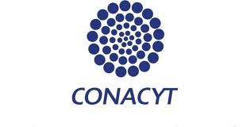

# RegulonDB Funding

## Current Support

RegulonDB is currently supported by the National Autonomous University of Mexico (UNAM) through the Center for Genomic Sciences (CCG). UNAM provides institutional positions for the project leader and three technical staff members, and the institutional setting in which the resource is developed, maintained, and hosted.

## Past Funding

Over the years, RegulonDB has been funded by:

- **National Autonomous University of Mexico (UNAM)**, Center for Genomic Sciences. RegulonDB has also benefited indirectly from UNAM fellowships for students and postdocs.

- **National Institutes of Health (NIH)**, National Institute of General Medical Sciences (NIGMS):
   - RegulonDB development and curation: GM071962.
   - EcoCyc grant supporting RegulonDB curation: GM077678.
   - Additional NIH grant: R01GM131643.

- **Consejo Nacional de Ciencia y Tecnología (CONACyT; now SECIHTI), Mexico**: grants 83686 G.I., CB2008-103686-Q and PROINNOVA-134817, including open-access publication charges (CB2008-103686-Q). RegulonDB has also benefited from CONACyT fellowships for Ph.D. students and postdocs.

 

 <table style="border:0px">
  <tr>
    <th></th>
    <th></th>
    <th></th>
  </tr>
 </table>

## Last Review

- Last updated: 2026-11-18
- Maintained by: RegulonDB Team
