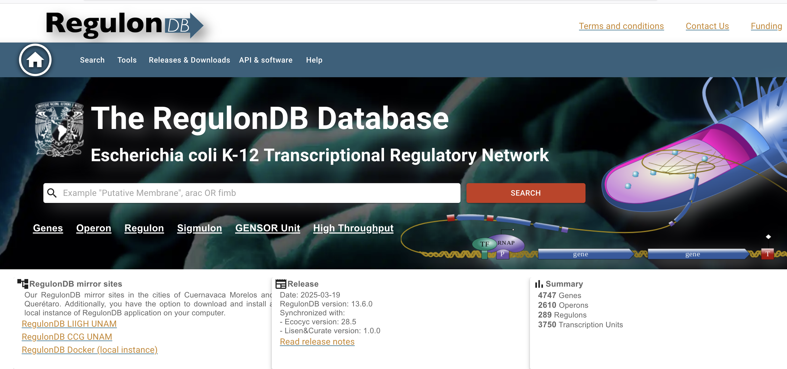

# Overview of Search and Navigation in RegulonDB

Welcome to the **Search and Navigation Guide** of RegulonDB.

This guide provides an introduction to the main biological entities available for search, how they are interconnected, and how to effectively use the search functionalities of RegulonDB to retrieve transcriptional regulation data.

---

## Searchable Objects in RegulonDB

The primary biological entities that can be searched individually are:

| Object         | Description |
|:---------------|:------------|
| **Gene**       | Genes annotated in *E. coli* K-12, including synonyms, locus tags, and descriptions. |
| **Operon**     | Groups of genes transcribed together, including associated promoters, transcription units, and terminators. |
| **Regulon**    | Sets of genes regulated by the same transcription factor. |
| **Sigmulon**   | Sets of genes transcribed by a common sigma factor. |
| **GENSOR Unit**| Genetic Sensory-Response Units, representing complete response modules for specific stimuli. |

Each of these objects can be searched individually, and search results often include related biological entities (e.g., promoters, transcription units, regulatory interactions).

---

## Search Functionalities

Searches start from the search bar on the RegulonDB home page; the links below it open the catalogs of genes, operons, regulons, sigmulons, GENSOR units, and high-throughput datasets.

- **Basic Search:**  
  Simple form-based searches by name, ID, function, or associated regulator.

- **Advanced Search Using Logical Operators:**  
  Combine terms with logical operators (`AND`, `OR`, `NOT`) and use quotation marks for exact phrases to refine your search results.  
  See [Using Logical Operators](logical_operators_search.md) for more details.

- **Exploration Through Links:**  
  Search results allow you to navigate easily between related objects (e.g., from a gene to its operon, regulatory interactions, or promoters).

---

## What You Can Find for Each Object

- **Gene Search:**  
  Name, locus tag, synonyms, associated operons, transcription units, regulatory interactions.

- **Operon Search:**  
  List of genes, structure of transcription units, associated promoters and terminators.

- **Regulon Search:**  
  Transcription factor overview, regulated genes, type of regulatory effects (activation, repression).

- **Sigmulon Search:**  
  Sigma factor overview, recognized promoters, regulated transcription units.

- **GENSOR Unit Search:**  
  Complete response models including sensing, signaling, and gene regulation pathways.

---

## Example Use Cases

- **Find all genes regulated by CRP:**  
  Search by regulator name in the Regulon search form.

- **Identify operons associated with lactose metabolism:**  
  Search by gene function or gene name related to lactose, and explore associated operons.

- **Retrieve all genes transcribed by sigma 70:**  
  Perform a Sigmulon search using the sigma factor's name.

- **Analyze the response of *E. coli* to arabinose:**  
  Search for the GENSOR Unit associated with arabinose sensing and response.

---

## Need Help?

If you encounter any difficulties or need guidance, please visit our [Contact Us](../00_about_policies/contact_us.md) page or consult the detailed guides for each search type:

- [Gene Search Guide](gene_search.md)
- [Operon Search Guide](operon_search.md)
- [Regulon Search Guide](regulon_search.md)

---

Happy exploring!

## Last Review

- Last updated: 2026-11-18
- Maintained by: RegulonDB Team
