# RegulonDB Glossary

This glossary defines the concepts used in RegulonDB to describe the regulation of gene expression in *Escherichia coli* K-12, and explains how each concept is represented in the RegulonDB data model and web interface.

**Sources.** The definitions follow the Ontology of Bacterial Gene Regulation, OBAGER (Mejía-Almonte *et al.*, forthcoming), and the definitions of transcription initiation concepts proposed by a group of experts (Mejía-Almonte *et al.*, 2020), complemented with the references cited in each entry. The representation of each concept corresponds to the data model of RegulonDB version 12.0. When the data do not yet follow a definition, usually because of missing information, this is indicated under **Notes on the data**.

**How to read each entry.** Each entry gives the definition, acronyms and synonyms, a description, a graphical representation when available, how the concept is represented in RegulonDB (**In RegulonDB**: collection, main fields, required fields according to the validation schema, and allowed values), notes on the data, an example, and references.

**OBAGER column.** In the **In RegulonDB** tables, *Required (schema)* indicates what the validation schema of the collection requires, and *OBAGER* indicates what the ontology requires: `required`, the definition cannot be met without the property; `required (complete)`, needed only for the complete form of the object; `optional`, the ontology explicitly allows the property to be absent; empty, not addressed by the ontology. The data model does not enforce the OBAGER requirements; the column serves to verify the data.

<!--
Internal notes for editors (not rendered):
- Entries, fields, or values that are defined in the data model but have no data yet are kept as HTML comments, to be published when data are available.
- Do not add counts or totals: this is a permanent glossary.
- Identifiers in examples must be checked at each release.
- Field names are those of the core collections (database regulondbmultigenomic); see 07_technical_reference/core_collections.
-->

## Contents

**Background**
 
- [Regulation of Gene Expression](#regulation-of-gene-expression)

**Genomic elements**
   
- [Gene](#gene)
- [Primary Transcript](#primary-transcript)
- [Transcription Unit](#transcription-unit)
- [Promoter](#promoter)
- [Terminator](#terminator)
- [Operon](#operon)
- [Binding Site and Regulatory Site](#binding-site-and-regulatory-site)

**Gene products and regulators**

- [Gene Product](#gene-product)
- [Regulator](#regulator)
- [Transcription Factor](#transcription-factor)
- [Regulatory Complex and Conformation](#regulatory-complex-and-conformation)
- [Sigma Factor](#sigma-factor)
- [Small RNA](#small-rna)
- [Regulatory Continuant and Effector](#regulatory-continuant-and-effector)

**Regulatory relationships**

- [Regulatory Interaction](#regulatory-interaction)

**Derived sets**

- [Regulon](#regulon)
- [Simple and Complex Regulon](#simple-and-complex-regulon)
- [Sigmulon](#sigmulon)
- [GENSOR Unit](#gensor-unit)

**Evidence and annotation**

- [Evidence and Confidence Level](#evidence-and-confidence-level)
- [Position Weight Matrix and Alignment](#position-weight-matrix-and-alignment)
- [Growth Condition](#growth-condition)

**Functional classes (Mejía-Almonte et al., forthcoming)**

- [Expression Machinery Component and Regulator Classes](#expression-machinery-component-and-regulator-classes)

---

## Regulation of Gene Expression

**Definition.** Regulation of gene expression is the capability of the cell to modify the amount of its gene products. Transcriptional regulation refers to the mechanisms that control gene expression at the level of transcription; regulation of transcription initiation controls the ability of RNA polymerase to start transcribing genes.

**Scope of RegulonDB.** RegulonDB focuses on the regulation of transcription initiation, and also represents post-transcriptional regulation by small RNAs and regulation that acts on proteins.

**Description.** The RNA polymerase (RNAP) holoenzyme (Eσ) is formed by the core RNAP (subunits α₂, β, β′ and ω) and a σ factor, and initiates transcription at specific DNA positions. σ interacts with promoter elements to position Eσ and unwind the DNA around the transcription start site (TSS), the first base of the transcript. Eσ first binds the promoter in a closed complex (RPc), covering approximately −55 to +15 relative to the TSS, and then forms an open complex (RPo) in which the DNA strands are separated. Promoter elements determine the intrinsic activity of a promoter, and promoters are regulated indirectly (for example, through changes in Eσ or substrate concentrations) or directly by specific regulators such as transcription factors (TFs). Transcription continues with elongation and ends at terminators, which can be intrinsic (Rho-independent) or Rho-dependent.

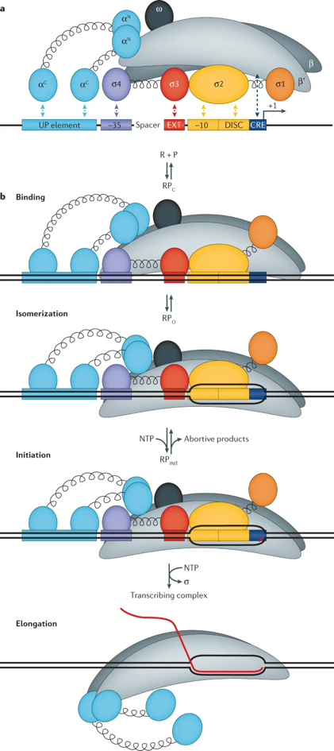

*Figure. The regulation of bacterial transcription initiation. From Mejía-Almonte C, et al. (2020) Redefining fundamental concepts of transcription initiation in bacteria. Nat Rev Genet 21:699–714. https://doi.org/10.1038/s41576-020-0254-8*

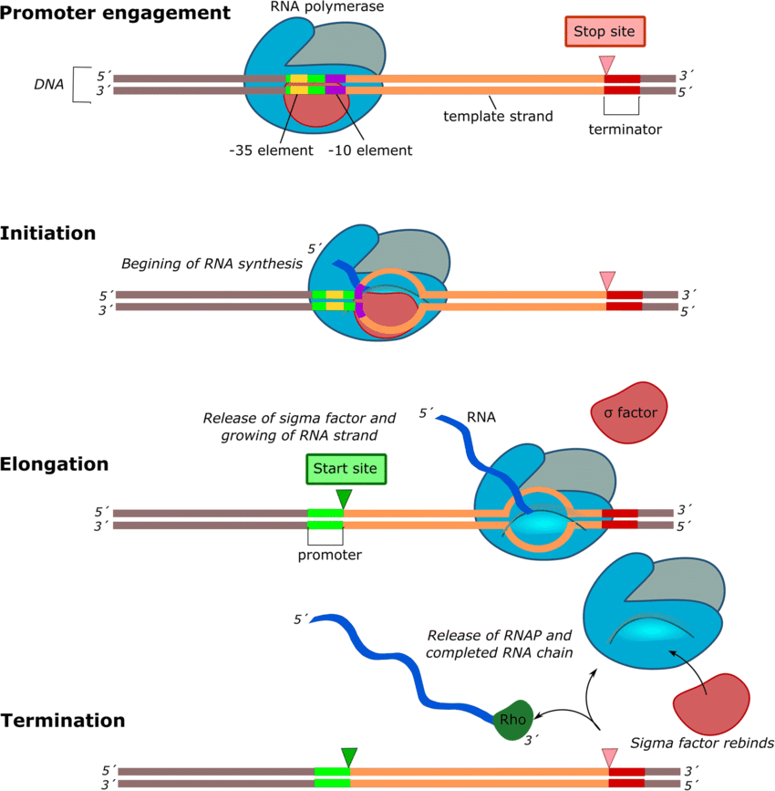

*Figure. Bacterial transcription process. From Abril AG, Rama JLR, Sánchez-Pérez A, Villa TG (2020) Role of the σ factor in the transcription process. Appl Microbiol Biotechnol. https://doi.org/10.1007/s00253-020-10577-0*

**References.** Mejía-Almonte *et al.* (2020), PMID: 32665585.

---

# Genomic Elements

## Gene

**Definition.** A bacterial gene is a continuous genomic DNA region carrying the information for at least one non-coding RNA or polypeptide chain, or a non-functional copy thereof (pseudogene). A gene represents a genomic locus rather than a one-to-one specification of a gene product. (Mejía-Almonte *et al.*, forthcoming)

**Acronyms and synonyms.** Locus.

**Description.**

- A single gene can give rise to several products through overlapping coding sequences expressed by frameshifting or by alternative transcriptional or translational events. For example, *dnaX* produces both the τ and γ subunits of DNA polymerase III by frameshifting; other *E. coli* genes with several products are *yibX*, *mcrB*, *cheA*, *copA*, and *infB*. (Mejía-Almonte *et al.*, forthcoming)
- Cistrons that code for subunits of heteromultimeric proteins are different genes; for example, *ihfA* and *ihfB*, which code for the two subunits of IHF.
- This view is consistent with GenBank, where genes are annotated as continuous loci even when the associated coding sequence is disrupted or spans several disjoint regions. (Mejía-Almonte *et al.*, forthcoming)
- RegulonDB keeps genes that were previously considered functional and are now classified as pseudogenes or phantom genes.

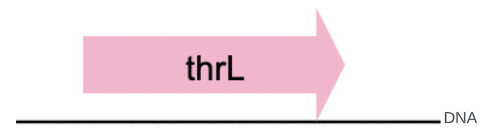

*Figure. Graphical representation of a DNA region with a gene. RegulonDB Drawing Traces Tool.*

**In RegulonDB.** Collection `genes`.

| Field | Description | Required (schema) | OBAGER | Example |
|---|---|:---:|:---:|---|
| `_id` | RegulonDB gene identifier | yes |  | `RDBECOLIGNC01250` |
| `name` | Gene name |  |  | `thrL` |
| `bnumber` | Blattner number |  |  | `b0001` |
| `leftEndPosition`, `rightEndPosition` | Absolute positions in the genome |  | required | 190, 255 |
| `strand` | DNA strand: `forward` or `reverse` |  | required | `forward` |
| `sequence` | Gene sequence |  |  | `ATGAAACGCATTAGC...` |
| `type` | Gene type: `pseudo`, `phantom` (no value for regular genes) |  |  | `pseudo` |
| `fragments`, `interrupted` | Coordinates of the segments of an interrupted gene |  | optional |  |
| `synonyms` | Other names |  |  | `EG11277` |

<!-- The schema also allows type = "truncated" and type = "gene"; no gene uses them yet. -->

**Notes on the data.**

- A **phantom gene** is a gene that was annotated in the past and is no longer supported as a gene; this term is not defined in OBAGER.
- Interrupted genes are stored as one gene with `fragments`, which is consistent with a gene being a single locus.
- A few genes have no coordinates or sequence.

**Examples.** *thrL* (`RDBECOLIGNC01250`, 190–255, forward); *dnaX* (`RDBECOLIGNC00239`), with two products: DNA polymerase III subunit τ (`RDBECOLIPDC00442`) and subunit γ (`RDBECOLIPDC03556`); pseudogene *rhsE* (`RDBECOLIGNC00008`).

**References.** Mejía-Almonte *et al.* (forthcoming); Mejía-Almonte *et al.* (2020).

## Primary Transcript

**Definition.** A primary transcript is the unedited RNA produced directly by transcription, extending from the first to the last templated base. It excludes post-transcriptionally added sequences, such as poly(A) tails and bases introduced by RNA editing. Nucleotides incorporated during transcription are part of the primary transcript, including those generated by reiterative transcription at the 5′ or 3′ ends or during elongation, and transcripts initiated with non-canonical nucleotides such as NAD⁺, NADH, dephospho-CoA, and FAD. (Mejía-Almonte *et al.*, forthcoming)

**Description.** The primary transcript is the basis for the definition of the transcription unit: the genomic boundaries of a transcription unit are inferred from its primary transcript.

**In RegulonDB.** There is no collection for transcripts. The ends of a primary transcript are represented by the transcription start site of the promoter (`promoters.transcriptionStartSite`) and the transcription termination site of the terminator (`terminators.transcriptionTerminationSite`).

**References.** Mejía-Almonte *et al.* (forthcoming).

## Transcription Unit

**Definition.** A transcription unit (TU) is a DNA segment that serves as a template for producing a primary transcript; it starts at a transcription start site (TSS) and ends at a transcription termination site (TTS). Strictly speaking, a TU is not necessarily transcribed into a gene. (Mejía-Almonte *et al.*, forthcoming)

**Acronyms and synonyms.** TU.

**Description.**
- When different TSSs of the same promoter are not differentially regulated, they form a single TU, limited by (but not including) a single promoter and a single terminator.
- This definition was proposed by RegulonDB and is included in the Sequence Ontology. Transcripts are the RNA molecules produced by RNA polymerase from TUs.
- An operon can contain several TUs, for example when it has alternative promoters or internal terminators (see [Operon](#operon)).

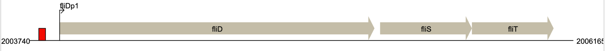

*Figure. Graphical representation of a transcription unit (fliDST). RegulonDB Drawing Traces Tool.*

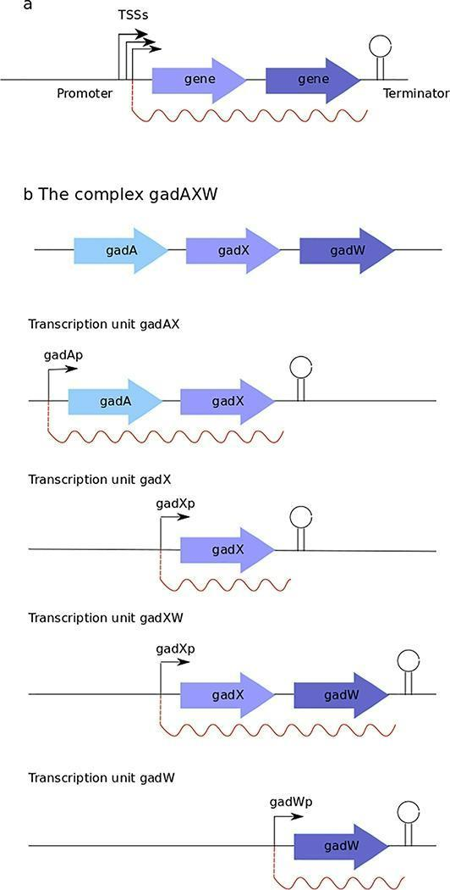

*Figure. Transcription unit and operon schematic: (a) a TU limited by a promoter and a terminator; (b) the complex operon gadAXW with several overlapping TUs. From Mejía-Almonte C, et al. (2020) Nat Rev Genet 21:699–714.*

**In RegulonDB.** Collection `transcriptionUnits`.

| Field | Description | Required (schema) | OBAGER | Example |
|---|---|:---:|:---:|---|
| `_id` | RegulonDB TU identifier | yes |  | `RDBECOLITUC03282` |
| `name` | TU name (the transcribed genes) |  |  | `thrLABC` |
| `genes_ids` | Genes transcribed in the TU | yes | optional |  |
| `operons_id` | Operon that contains the TU | yes | required | `RDBECOLIOPC02642` |
| `promoters_id` | Promoter where the TU starts (one) |  | required | `RDBECOLIPMC03512` |
| `terminators_ids` | Terminator(s) where the TU ends |  | required | `RDBECOLITMC00230` |

**Notes on the data.** The promoter and the terminator of a TU are recorded only when they are known; many TUs have no known promoter or terminator. A TU is named after its genes; different TUs of the same operon can have the same name when they differ only in their promoter.

**Example.** `thrLABC` (`RDBECOLITUC03282`), transcribed from promoter `RDBECOLIPMC03512` and ending at terminator `RDBECOLITMC00230`.

**References.** Mejía-Almonte *et al.* (2020); Mejía-Almonte *et al.* (forthcoming).

## Promoter

**Definition.** A promoter is a DNA segment essential for the specific initiation of transcription at a defined location in a DNA molecule, although this location might not be one single base. It is recognized by a specific RNA polymerase holoenzyme (Eσ), and this recognition is not necessarily autonomous. (Mejía-Almonte *et al.*, 2020) In OBAGER, a promoter is both a component of the expression machinery and a cis-acting transcriptional regulator: it establishes the transcription start point and contributes to determining transcriptional output. (Mejía-Almonte *et al.*, forthcoming)

**Acronyms and synonyms.** Promoter region.

**Description.**
- Promoter sequences are specific to the different σ factors. A promoter is represented as a stretch of 60 nucleotides upstream and 20 downstream of the transcription start site (TSS, +1), shown in upper case; the σ-binding motifs are marked as boxes (−10 and −35 for σ70; −12 and −24 for σ54).
- Promoter names inherit the name of the first transcribed gene, followed by "p".
- A single promoter can have several TSSs within a 5-bp region, reflecting the flexibility of TSS selection in the open complex; a main TSS is kept when known.
- Different σ factors initiating at the same TSS define different promoters. For example, *glmY* is transcribed from two overlapping promoters, one recognized by σ54 and the other by σ70.
- Promoters associated with NAD⁺ capping have been experimentally characterized. (Mejía-Almonte *et al.*, forthcoming)

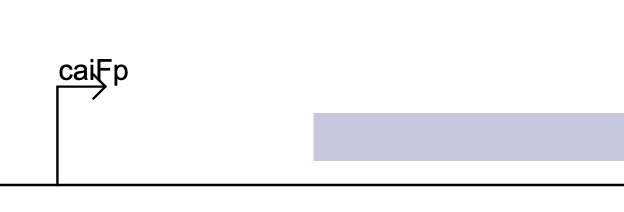

*Figure. Graphical representation of a promoter. RegulonDB Drawing Traces Tool.*

**In RegulonDB.** Collection `promoters`.

| Field | Description | Required (schema) | OBAGER | Example |
|---|---|:---:|:---:|---|
| `_id` | RegulonDB promoter identifier | yes |  | `RDBECOLIPMC03962` |
| `name` | Promoter name |  |  | `caiFp` |
| `transcriptionStartSite` | TSS (+1): `leftEndPosition`, `rightEndPosition`, `range`, and `type` (`primary`, `secondary`, `tertiary`) |  | required | 34218 |
| `bindsSigmaFactor` | σ factor that recognizes the promoter |  | required | `RDBECOLISFC00003` (σ70) |
| `boxes` | σ-binding motifs; `type`: `minus10`, `minus35`, `minus12`, `minus24` |  |  |  |
| `sequence` | Promoter sequence (+1 in upper case) |  |  |  |
| `strand` | DNA strand |  |  | `forward` |

**Notes on the data.** The σ factor is not recorded for every promoter.

**Examples.** `caiFp` (`RDBECOLIPMC03962`, TSS 34218, σ70). The two overlapping promoters of *glmY*: `glmYp1` (`RDBECOLIPMC03121`, σ54) and `glmYp2` (`RDBECOLIPMC00323`, σ70), both with TSS 2691340.

**References.** Mejía-Almonte *et al.* (2020); Mejía-Almonte *et al.* (forthcoming).

## Terminator

**Definition.** A terminator is a nucleotide segment at which transcription ends and RNA polymerase releases the transcript; the terminator is the segment, not the termination process itself. (Mejía-Almonte *et al.*, forthcoming)

**Acronyms and synonyms.** TTS: transcription termination site.

**Description.**
- Bacterial transcription termination can occur through intrinsic mechanisms, factor-dependent mechanisms, or combinations of both. Intrinsic (Rho-independent) termination relies on nucleic-acid features: a GC-rich hairpin in the nascent RNA followed by a run of U residues. Rho-dependent termination requires the Rho protein, an RNA helicase that disrupts the elongation complex. (Mejía-Almonte *et al.*, forthcoming)
- Termination does not always occur at a defined sequence: Mfd terminates transcription at sites of DNA damage by recognizing stalled RNA polymerase, a mechanism of termination without a defined terminator. (Mejía-Almonte *et al.*, forthcoming)
- Collision-driven termination between convergent TUs, promoted by hairpin structures at overlapping termination regions, may be considered a non-canonical intrinsic terminator. Intrinsic and Rho-dependent termination can occur sequentially or at overlapping sites, so some regions may represent a single hybrid signal or several overlapping terminators. (Mejía-Almonte *et al.*, forthcoming)
- A terminator marks the end of a transcription unit; it can be shared by several TUs.

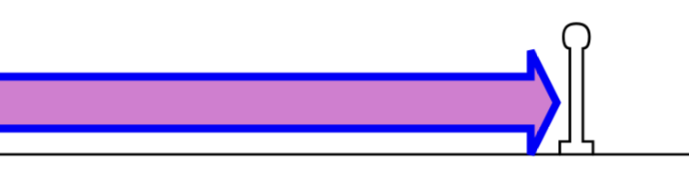

*Figure. Graphical representation of a terminator in RegulonDB. RegulonDB Drawing Traces Tool.*

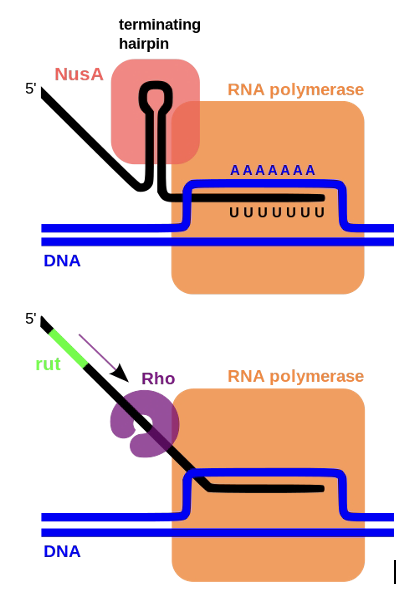

*Figure. Intrinsic (top) and Rho-dependent (bottom) termination. Adapted from "Prokaryotic terminators", Wikimedia Commons.*

**In RegulonDB.** Collection `terminators`.

| Field | Description | Required (schema) | OBAGER | Example |
|---|---|:---:|:---:|---|
| `_id` | RegulonDB terminator identifier | yes |  | `RDBECOLITMC00001` |
| `class` | `rho-independent` or `rho-dependent` | yes | required | `rho-independent` |
| `transcriptionTerminationSite` | TTS: `leftEndPosition`, `rightEndPosition`, `type` | yes | required | 3407286–3407302 |
| `sequence` | Terminator sequence | yes |  |  |

**Notes on the data.** The data model distinguishes only two classes, Rho-independent and Rho-dependent; hybrid, overlapping, and non-canonical terminators are not yet classified. The terminator does not store its strand or its TUs; each TU points to its terminators (`transcriptionUnits.terminators_ids`).

**References.** Mejía-Almonte *et al.* (forthcoming); Mejía-Almonte *et al.* (2020).

## Operon

**Definition.** An operon is a genomic organization unit comprising adjacent genes whose transcription is coordinated by overlapping transcription units and their associated cis-regulatory elements. A region of a monocistronic TU that does not overlap any other TU is considered a single-gene operon. (Mejía-Almonte *et al.*, forthcoming)

**Description.**
- The definition retains the classical concept of Jacob and Monod and explicitly incorporates the promoter and other cis-regulatory elements that determine transcript initiation and its regulation. It is consistent with the etymology of *operon* (from *opus*, a work or construction): the operon is the genomic "construction platform" that includes the promoter and the transcription factor binding sites. (Mejía-Almonte *et al.*, forthcoming)
- In RegulonDB, an operon extends from the most upstream regulatory site to the termination site of the last TU, and can contain internal promoters and transcription factor regulatory sites. Because promoters are cis-acting regulators, the definition also applies to bacteria with reduced reliance on transcription factors. (Mejía-Almonte *et al.*, forthcoming)
- A **simple operon** is one whose genes are transcribed through a single TU; a **complex operon** is one whose transcription is coordinated through several overlapping TUs transcribed in the same direction and sharing at least one gene.
- The classical definition, "a group of genes transcribed as a single polycistronic mRNA controlled by an operator and a promoter", does not cover current knowledge; for instance, operons are frequently regulated by several operators.

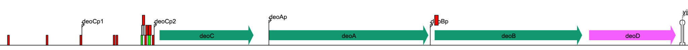

*Figure. deoCABD operon region: 4 genes, 4 promoters, 4 transcription units. RegulonDB Drawing Traces Tool.*

**In RegulonDB.** Collection `operons`.

| Field | Description | Required (schema) | OBAGER | Example |
|---|---|:---:|:---:|---|
| `_id` | RegulonDB operon identifier | yes |  | `RDBECOLIOPC02642` |
| `name` | Operon name | yes |  | `thrLABC` |
| `regulationPositions` | Left and right ends of the operon, including its regulatory region | yes | required | 148–5086 |
| `strand` | DNA strand |  | required | `forward` |

**Notes on the data.** The genes and TUs of an operon are obtained through its TUs (`transcriptionUnits.operons_id`).

**Examples.** `thrLABC` (`RDBECOLIOPC02642`), `lacZYA` (`RDBECOLIOPC02880`), `deoCABD` (`RDBECOLIOPC02832`).

**References.** Mejía-Almonte *et al.* (forthcoming); Mejía-Almonte *et al.* (2020); Jacob F (1966) Genetics of the bacterial cell. Science 152:1470–1478.

## Binding Site and Regulatory Site

**Definitions.** (Mejía-Almonte *et al.*, 2020; Mejía-Almonte *et al.*, forthcoming)
1. **Transcription factor binding site (TFBS):** a DNA site where a TF binds specifically.
2. **Transcription factor regulatory site (TFRS):** the subset of TFBSs involved in transcription regulation. In OBAGER, the TFRS is part of a complete regulatory interaction.
3. **Regulator binding site (R-BS):** a site where regulators such as small RNAs and metabolites bind.
4. **Regulator regulatory site (R-RS):** the subset of R-BSs involved in regulation.

**Acronyms and synonyms.** Operator; BS: binding site; RS: regulatory site; TFBS, TFRS; sRNA-BS: small RNA binding site; sRNA-RS: small RNA regulatory site.

**Description.** Since RegulonDB version 12.0, binding sites with an effect on the regulated promoter are called TFRSs, unlike TFBSs, which may or may not have an effect. The distinction matters because high-throughput binding methods identify TFBSs, most of which lack evidence of a regulatory role. RNA regulatory binding sites in the mRNA are cis-acting post-transcriptional regulators. (Mejía-Almonte *et al.*, forthcoming)

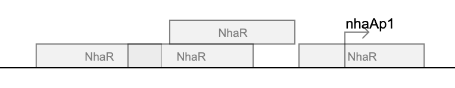

*Figure. Graphical representation of binding sites (NhaR). RegulonDB Drawing Traces Tool.*

**In RegulonDB.** Collection `regulatorySites`.

| Field | Description | Required (schema) | OBAGER | Example |
|---|---|:---:|:---:|---|
| `_id` | RegulonDB site identifier | yes |  |  |
| `leftEndPosition`, `rightEndPosition` | Absolute positions in the genome |  | required | 70110, 70126 |
| `sequence` | Site sequence |  |  | `TCAGGTAGGATCCGCTA` |
| `length` | Site length |  |  | 17 |
| `regulationType` | `Transcription`, `sRNA-Regulation`, or `Protein-Regulation` |  |  |  |

**Notes on the data.** One collection holds all sites, including the sites of small RNAs. The data do not flag whether a site is a binding or a regulatory site, and the site does not store its regulator or strand: both are obtained from the regulatory interaction that uses the site (`regulatoryInteractions.regulatorySites_id`).

**References.** Mejía-Almonte *et al.* (2020); Mejía-Almonte *et al.* (forthcoming).

<!--
## Attenuator

**Definition.** A control region at the promoter end, usually of repressible amino acid operons, that exerts transcriptional control based on the translation of a small leader peptide gene.

**Description.** Attenuation is a regulatory mechanism that results in premature termination of transcription. For example, the attenuator adjacent to the structural genes of the trp operon reduces transcription in the presence of tryptophan. Attenuators in RegulonDB were predicted computationally: for each predicted operon, the upstream region of the first gene is scanned for runs of Us; a stable structure is searched for in the adjacent region and, if a terminator is found, an anti-terminator and an anti-antiterminator are searched for.

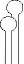
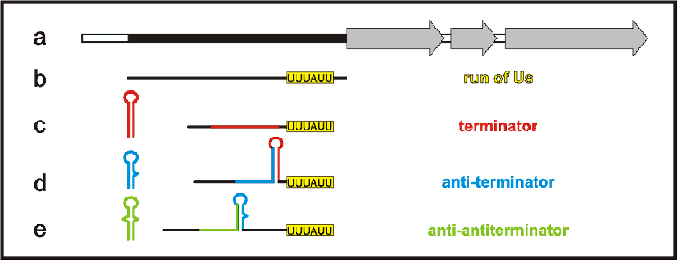
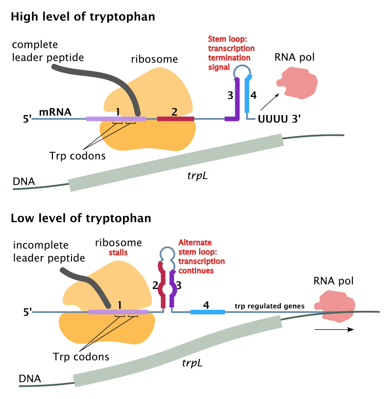

**In RegulonDB.** Not included in the current data model. Keep commented until attenuators are available again.
-->

<!--
## Riboswitch

**Definition.** Riboswitches are gene control elements, mostly found in the 5′-UTR of bacterial mRNAs, that directly bind specific ligands (usually metabolites) to regulate gene expression without the need for proteins.

**Description.** Riboswitches regulate transcription (through terminator/anti-terminator structures) or translation (by blocking the ribosome-binding site upon ligand binding).

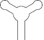
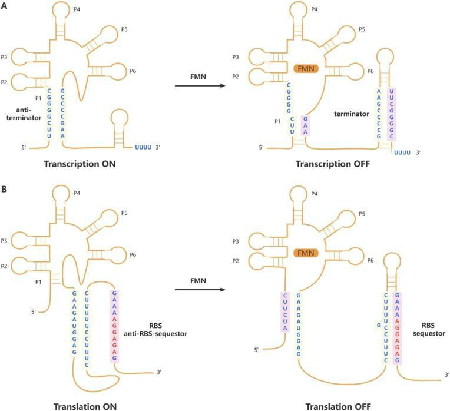
Figure. Two main regulatory mechanisms of riboswitches. From Xu J, et al. (2023) Riboswitches, from cognition to transformation. Synth Syst Biotechnol 8:357-370. PMID: 37325181.

**In RegulonDB.** Not included in the current data model (the schema defines a collection "rfams" that is not exported). Keep commented until riboswitches are available.
-->

---

# Gene Products and Regulators

## Gene Product

**Definition.** A gene product is a functional biomacromolecule produced by transcription, or by transcription followed by translation, from a gene, including complexes formed from such biomacromolecules. Messenger RNAs, whose primary role is to carry genetic information between DNA and the ribosome, are not gene products. Gene products are **simple** when derived from a continuous DNA sequence, and **complex** when formed from two or more simple gene products, such as multisubunit proteins and RNA–protein complexes like the ribosome. (Mejía-Almonte *et al.*, forthcoming)

**Description.** Functional RNAs (tRNAs, rRNAs, small regulatory RNAs) are gene products. The relationship between a gene and its products is not one-to-one: a gene can have several products, as in *infB* and *copA*, which generate protein isoforms from alternative or internal start codons; conversely, a polypeptide can participate in several complexes. (Mejía-Almonte *et al.*, forthcoming)

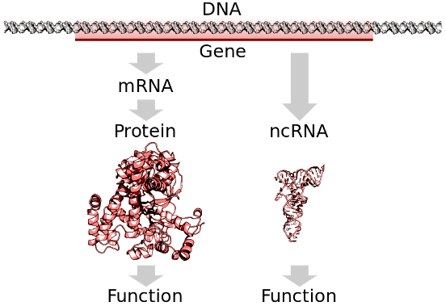

*Figure. From gene to gene products.*

**In RegulonDB.** Collection `products` (simple gene products); complexes with a regulatory role are in `regulatoryComplexes` (see [Regulatory Complex and Conformation](#regulatory-complex-and-conformation)).

| Field | Description | Required (schema) | OBAGER | Example |
|---|---|:---:|:---:|---|
| `_id` | RegulonDB product identifier | yes |  | `RDBECOLIPDC00388` |
| `genes_id` | Gene that codes for the product | yes | required | `RDBECOLIGNC00043` |
| `name` | Product name |  |  | DUF525 domain-containing protein ApaG |
| `type` | Product type for RNAs: `small RNA`, `tRNAs`, `rRNA`, `tmRNA` (no value for proteins) |  |  | `small RNA` |
| `sequence` | Amino acid or RNA sequence |  |  |  |
| `molecularWeight`, `locations` | Molecular weight and cellular location |  |  |  |

**Notes on the data.** Only complexes with a regulatory role are represented as complex gene products. Proteins have no `type` value.

**Example.** Gene *infB* (`RDBECOLIGNC00497`) has three products: translation initiation factor IF-2 (`RDBECOLIPDC00529`), IF-2β (`RDBECOLIPDC03803`), and IF-2β′ (`RDBECOLIPDC03804`).

**References.** Mejía-Almonte *et al.* (forthcoming); Mejía-Almonte *et al.* (2020).

## Regulator

**Definition.** A regulator is a material entity observed to influence the activity of another regulator or of a component of the expression machinery, or to affect the expression of a unit of expression, within a signal–effector response circuit. (Mejía-Almonte *et al.*, forthcoming) Any gene product that increases or decreases the expression of a specific set of genes is a regulatory gene product. (Mejía-Almonte *et al.*, 2020)

**Acronyms and synonyms.** Regulatory gene product; TF: transcription factor; sRNA: small RNA.

**Description.**
- Regulatory gene products are RNA regulators or regulatory proteins, further divided by the level at which they act and their mechanism. Among regulatory proteins, the DNA-binding regulators of transcription initiation include transcription factors and σ factors; the RNAP-centered regulatory proteins, such as DksA, regulate initiation through their interaction with the RNAP holoenzyme instead of binding DNA.
- The RegulonDB conceptual model represents regulators in three classes: gene products, regulatory elements not encoded in the DNA (such as ppGpp), and their combinations in regulatory complexes. These, with their active and inactive conformations, are the regulators in regulatory interactions.
- In OBAGER, regulator subclasses are inferred from the chemical identity of the entity and the regulatory interactions in which it participates (see [Expression Machinery Component and Regulator Classes](#expression-machinery-component-and-regulator-classes)).

| Small RNA | Transcription factor |
|:---:|:---:|
| 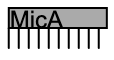 |  |

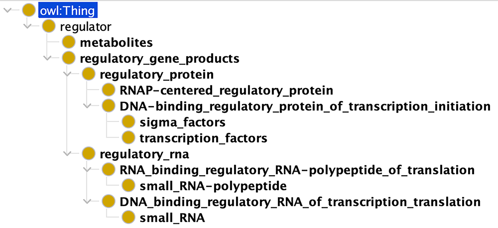

*Figure. Classification of regulators.*

**In RegulonDB.** Collection `regulators`.

| Field | Description | Required (schema) | OBAGER | Example |
|---|---|:---:|:---:|---|
| `_id` | Identifier (a TF identifier, or the product identifier for small RNAs) | yes |  | `RDBECOLITFC00220` |
| `type` | `transcriptionFactor`, `small RNA`, or `regulatoryContinuant` | yes | required | `transcriptionFactor` |
| `name`, `abbreviatedName` | Full and short name |  |  | AraC |
| `regulatorClass` | Chemical class (for example, polypeptides, regulatory RNAs) |  |  |  |
| `conformations` | Conformations of the regulator |  |  |  |

**Notes on the data.** Regulators are transcription factors, small RNAs, and one regulatory continuant, ppGpp. The effect of a regulator (activator, repressor) is a property of each regulatory interaction; the overall effect of a TF is in `transcriptionFactors.globalFunction`.

**References.** Mejía-Almonte *et al.* (forthcoming); Mejía-Almonte *et al.* (2020).

## Transcription Factor

**Definition.** A transcription factor (TF) is a trans-acting regulator that recognizes specific DNA sites, its transcription factor regulatory sites, and inherits its transcriptional regulatory role through that recognition. (Mejía-Almonte *et al.*, forthcoming)

**Acronyms and synonyms.** TF.

**Description.** TFs are usually allosteric proteins that bind their operator sites, generally near promoters, in a holo or apo conformation. A TF acts in a **holo** conformation when it binds DNA as a complex with an effector, either a non-covalently bound small molecule or a covalent modification (for example, phosphorylation in two-component systems); it acts in an **apo** conformation when it binds DNA without an effector. The activity of most TFs is linked to external signals, which makes gene expression highly sensitive to environmental changes. Activators compensate for the intrinsic weakness of promoters; repressors reduce promoter activity.

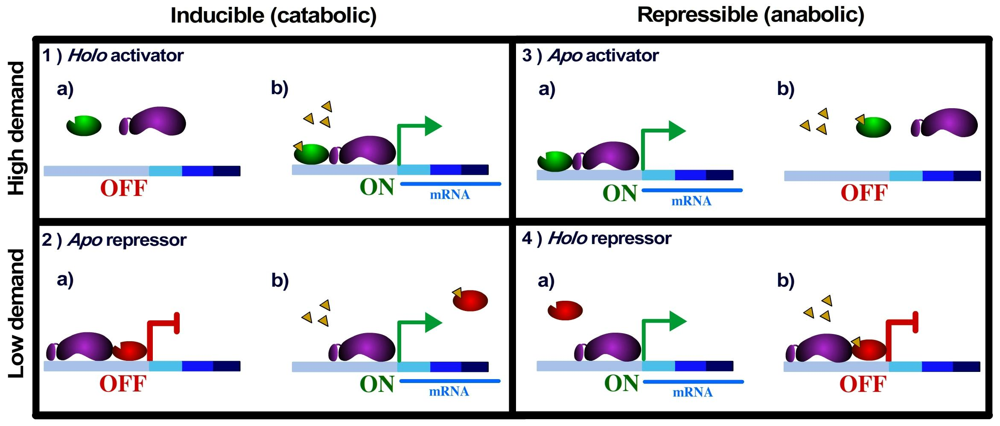

*Figure. Holo and apo conformations of transcription factors. From Balderas-Martínez YI, et al. (2013) Predicted gene control circuits for simple cases. PLoS One. https://doi.org/10.1371/journal.pone.0065723*

**In RegulonDB.** Collection `transcriptionFactors`.

| Field | Description | Required (schema) | OBAGER | Example |
|---|---|:---:|:---:|---|
| `_id` | RegulonDB TF identifier | yes |  | `RDBECOLITFC00220` |
| `name`, `abbreviatedName` | Full and short name |  |  | DNA-binding transcriptional dual regulator AraC |
| `activeConformations`, `inactiveConformations` | Conformations of the TF (products or regulatory complexes) |  | required (complete): active conformation |  |
| `globalFunction` | Overall effect: `activator`, `repressor`, or `dual` |  |  | `dual` |
| `products_ids` | Products that form the TF |  | required |  |
| `family`, `symmetry`, `siteLength` | TF family, symmetry and length of its sites |  |  |  |

**Example.** AraC (`RDBECOLITFC00220`, global function dual) has two active conformations, `RDBECOLIRCC00202` (AraC) and `RDBECOLIRCC00007` (AraC–α-L-arabinopyranose), and one inactive conformation, `RDBECOLIRCC00149` (AraC–D-fucose).

**References.** Mejía-Almonte *et al.* (forthcoming); Mejía-Almonte *et al.* (2020); Balderas-Martínez *et al.* (2013).

## Regulatory Complex and Conformation

**Definition.** A regulatory complex is a complex gene product, or a complex of a gene product with a regulatory continuant, that participates as a regulator in regulatory interactions. A conformation is a structural state of a regulator; an **active conformation** is the state that regulates its targets, and an **inactive conformation** is a state that does not. (Mejía-Almonte *et al.*, forthcoming)

**Description.** Molecular complexes are classified by their participation in regulatory interactions; for example, a protein bound to a DNA site is recognized as a biomacromolecular regulator. Several TFs can act either as part of a heteromeric complex or independently, as in the MazE–MazF system. (Mejía-Almonte *et al.*, forthcoming)

**In RegulonDB.** Collection `regulatoryComplexes`.

| Field | Description | Required (schema) | OBAGER | Example |
|---|---|:---:|:---:|---|
| `_id` | RegulonDB complex identifier | yes |  | `RDBECOLIRCC00004` |
| `name` | Complex name |  |  | RhaS-L-rhamnose DNA-binding transcriptional activator |
| `type` | `active` or `inactive` |  |  | `active` |
| `products` | Products in the complex |  | required | `RDBECOLIPDC03938` (RhaS) |
| `regulatoryContinuants_ids` | Effectors or other continuants in the complex |  |  | `RDBECOLICNC00086` (L-rhamnose) |

**Notes on the data.** Only complexes with a regulatory role are represented, in their active and inactive conformations.

**References.** Mejía-Almonte *et al.* (forthcoming).

## Sigma Factor

**Definition.** A σ factor is the RNA polymerase subunit that, in the holoenzyme (Eσ), directs promoter recognition. In OBAGER, σ factors are both essential components of the transcription machinery and regulators that determine promoter selectivity and transcriptional output. (Mejía-Almonte *et al.*, forthcoming)

**Description.** Most bacteria rely on different σ factors to take Eσ to different sets of promoters in response to changes in growth conditions. σ70-related factors contain up to four domains (σ1–σ4): σ2 recognizes the −10 element and σ4 the −35 element; σ3 interacts with the extended −10 element. The evolution of σ factors increased the efficiency and specificity of transcription by facilitating DNA opening, promoter selection, and stabilization of initiation complexes; promoters become functional only when recognized by the transcription machinery, and σ factors derive their regulatory role through promoter recognition. (Mejía-Almonte *et al.*, forthcoming)

**In RegulonDB.** Collection `sigmaFactors`.

| Field | Description | Required (schema) | OBAGER | Example |
|---|---|:---:|:---:|---|
| `_id` | RegulonDB σ factor identifier | yes |  | `RDBECOLISFC00003` |
| `name` | Full name | yes |  | RNA polymerase sigma factor RpoD |
| `abbreviatedName` | Short name |  |  | `sigma70` |
| `genes_id` | Gene that codes for the σ factor | yes | required |  |

**Notes on the data.** The σ factors represented are σ70 (RpoD), σ54 (RpoN), σ38 (RpoS), σ32 (RpoH), σ28 (FliA), σ24 (RpoE), and σ19 (FecI). The promoters recognized by each σ factor are recorded in `promoters.bindsSigmaFactor`.

**References.** Mejía-Almonte *et al.* (forthcoming); Mejía-Almonte *et al.* (2020).

## Small RNA

**Definition.** A small regulatory RNA (sRNA) is a trans-acting regulator that inherits its post-transcriptional regulatory role through the recognition of its target binding sites in the mRNA. (Mejía-Almonte *et al.*, forthcoming)

**Acronyms and synonyms.** sRNA; small RNA; regulatory RNA.

**Description.** sRNAs usually modulate the stability or translation of their target mRNAs, frequently with the help of chaperones such as Hfq. Their target sites are small RNA binding sites (sRNA-BS) and, when involved in regulation, small RNA regulatory sites (sRNA-RS). (Mejía-Almonte *et al.*, forthcoming)

**In RegulonDB.** sRNAs are regulators of type `small RNA` (collection `regulators`) whose identifier is that of their gene product. Their interactions have `regulationType` = `sRNA-Regulation`.

**Example.** CyaR (`RDBECOLIPDC04264`); MicA (`RDBECOLIPDC04311`).

**References.** Mejía-Almonte *et al.* (forthcoming).

## Regulatory Continuant and Effector

**Definitions.**
- A **regulatory continuant** is a regulatory entity that is not encoded in the DNA, typically a small molecule, that participates in regulation either by binding a regulator or by acting as a regulator itself.
- An **effector** is the precise metabolite that binds to a TF, altering its conformation and switching its binding or unbinding to its sites. Most effectors are metabolites that bind non-covalently to an allosteric site of the TF; covalent modifications, such as the phosphorylation of two-component TFs, are also considered effectors.

**Description.**
- An effector is distinct from a **signal**. Signals act at the physiological level by initiating the flow of information within the cell; effectors act at the mechanistic level by interacting with regulators. In some cases the signal is the effector (see [GENSOR Unit](#gensor-unit)).
- Some continuants regulate without a TF. The alarmone ppGpp binds two sites of the RNAP holoenzyme: site 1 affects elongation and pausing, and site 2, together with DksA, affects transcription initiation and promoter selectivity. (Mejía-Almonte *et al.*, forthcoming)

**In RegulonDB.** Collection `regulatoryContinuants`.

| Field | Description | Required (schema) | OBAGER | Example |
|---|---|:---:|:---:|---|
| `_id` | RegulonDB continuant identifier | yes |  | `RDBECOLICNC00086` |
| `name` | Name | yes |  | L-rhamnose |
| `type` | `metabolite` |  |  | `metabolite` |
| `isRegulator` | `true` when the continuant acts as a regulator itself |  |  | `true` (ppGpp) |

<!-- The schema also allows type = "protein"; no continuant uses it yet. -->

**Notes on the data.** Regulatory continuants are mostly metabolites. Covalent modifications are not stored as continuants: phosphorylated forms of a TF are represented as conformations of the TF (regulatory complexes), for example OmpR-phosphorylated (`RDBECOLIRCC00220`).

**Examples.** L-rhamnose (`RDBECOLICNC00086`), the effector of RhaS; ppGpp (`RDBECOLICNC00080`), a regulatory continuant that acts as a regulator.

**References.** Mejía-Almonte *et al.* (2020); Mejía-Almonte *et al.* (forthcoming).

---

# Regulatory Relationships

## Regulatory Interaction

**Definition.** A regulatory interaction (RI) is a quadruple (T, R, R-RS, F), where T is the target of regulation, R is the regulator, R-RS is the site where the regulator binds and participates in the regulation, and F is the regulatory effect on the target. (Mejía-Almonte *et al.*, 2020) A complete RI specifies the active TF, its transcription factor regulatory site (TFRS), the promoter, and the regulatory effect (activation or repression), because the effect depends on the specific context in which the TF binds DNA. (Mejía-Almonte *et al.*, forthcoming)

**Acronyms and synonyms.** RI.

**Description.**
- Some experiments identify regulatory relationships without enough evidence to reconstruct the full molecular context. For this reason, since version 12.0 RegulonDB represents three types of RI according to how well the regulated entity is characterized: **TF–promoter** (best characterized; the target genes are those transcribed from the regulated promoter), **TF–TU** (the regulated promoter is unknown, but the regulated genes belong to a known TU), and **TF–gene** (only an effect on the downstream gene is known). (Mejía-Almonte *et al.*, forthcoming)
- In OBAGER, RIs are classes with a regulator and a regulated entity; the most detailed RIs have a TF bound to its TFRS as regulator. There are also RI classes with small RNAs as trans-acting regulators. (Mejía-Almonte *et al.*, forthcoming)
- Each RI has one effect: activation or repression. When a regulator activates a target under some conditions and represses it under others, this is represented as two RIs; the **dual** effect appears only when the RIs are grouped, for example in a regulon.

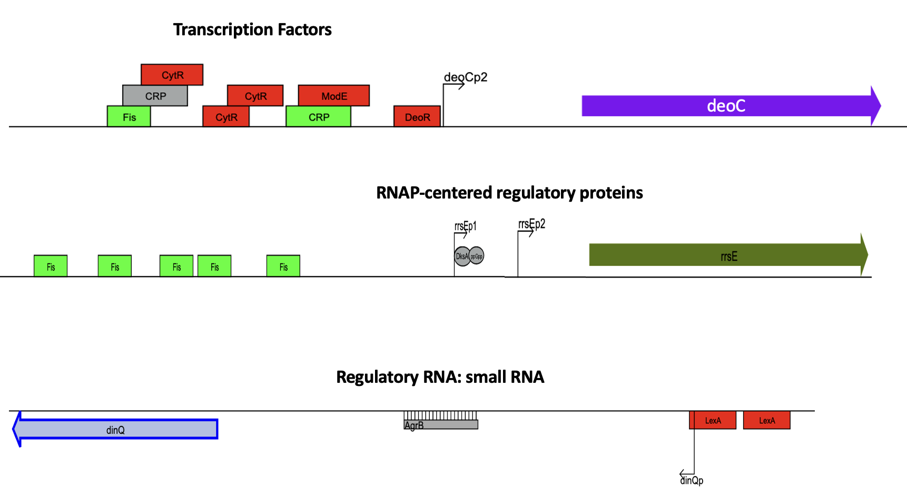

*Figure. Three types of regulators: transcription factors, RNAP-centered regulatory gene products, and small RNA regulators. RegulonDB Drawing Traces Tool.*

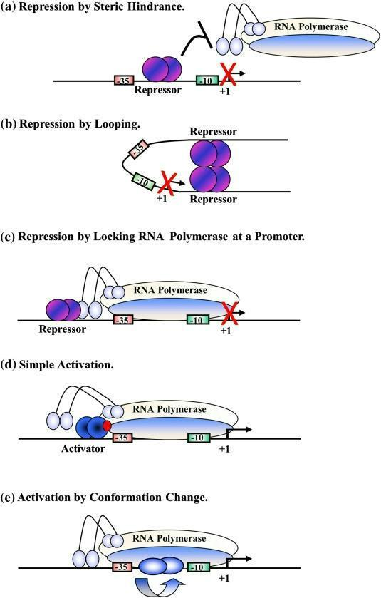

*Figure. Mechanisms of repression and activation by transcription factors at bacterial promoters. From Browning DF, Butala M, Busby SJW (2019) J Mol Biol. https://doi.org/10.1016/j.jmb.2019.04.011*

**In RegulonDB.** Collection `regulatoryInteractions`.

| Field | Description | Required (schema) | OBAGER | Example |
|---|---|:---:|:---:|---|
| `_id` | RegulonDB RI identifier | yes |  | `RDBECOLIRIC00001` |
| `regulator` | Regulator: `_id`, `name`, `type` (`regulatoryComplex`, `product`, `regulatoryContinuant`) |  | required | GadW (`product`) |
| `regulatedEntity` | Target: `_id`, `name`, `type` (`promoter`, `transcriptionUnit`, `gene`) |  | required | `slpp` (`promoter`) |
| `function` | Effect: `activator` or `repressor` |  | required | `repressor` |
| `regulatorySites_id` | Regulatory site of the interaction |  | required (complete) |  |
| `relativeDistSitePromoter` | Distance from the center of the site to the TSS |  |  | −60.5 |
| `regulationType` | `Transcription`, `sRNA-Regulation`, or `Protein-Regulation` |  |  | `Transcription` |
| `confidenceLevel` | `C`, `S`, or `W` (see [Evidence and Confidence Level](#evidence-and-confidence-level)) |  |  | `W` |

<!--
Fields and values defined in the schema without data yet (keep commented):
- regulatedEntity.type = "srna" (an sRNA as the regulated entity).
- type = "mechanistic" or "physiological".
- function = "dual" is allowed by the schema but is not used in individual RIs (dual RIs were split into two RIs); "dual" is used only when RIs are grouped in a regulon.
-->

**Notes on the data.** The regulated entity can be a promoter, a gene, or a TU, depending on how well the interaction is characterized. The site and the distance to the promoter are recorded only when known.

**Example.** `RDBECOLIRIC00001`: GadW represses promoter `slpp` (`RDBECOLIPMC03434`); the site is centered 60.5 bp upstream of the TSS; confidence level weak.

**References.** Mejía-Almonte *et al.* (2020); Mejía-Almonte *et al.* (forthcoming); Browning *et al.* (2019).

---

# Derived Sets

## Regulon

**Definition.** A regulon is a set of expression units, which may be distributed throughout the genome, whose expression is co-regulated by the same trans-acting regulator or regulatory complex through a common, target-specific mechanism. The specificity may arise, for example, from direct recognition of a cis-regulatory element or from modulation of the affinity of RNA polymerase or the ribosome for different sites. A regulon can therefore include transcriptional and translational targets. (Mejía-Almonte *et al.*, forthcoming)

**Description.**
- The classical concept of a regulon refers to genes controlled by a common trans-acting regulator (Maas, 1964). OBAGER broadens it to include regulatory mechanisms that do not involve encoded molecules, such as the alarmone ppGpp. (Mejía-Almonte *et al.*, forthcoming)
- For a regulatory mechanism to define a regulon, its action must confer specificity for a defined set of targets; effects that alter gene expression globally do not define a regulon. For example, the effects of ppGpp on RNAP and on translation acquire target specificity from promoter or mRNA features and define regulons, whereas its effects on ribosome assembly do not. (Mejía-Almonte *et al.*, forthcoming)
- A regulon is different from a **stimulon**, the set of all genes whose expression changes in response to a common stimulus, regardless of mechanism, including direct and indirect effects. (Mejía-Almonte *et al.*, forthcoming)
- Although regulons are often treated as functionally coherent groups, their members are rarely homogeneous with respect to biological processes. (Mejía-Almonte *et al.*, forthcoming)

**In RegulonDB.** The regulon is a derived object: it is built at each release from the regulators and their regulatory interactions, and is shown on the regulon pages and in the regulon catalog of the web interface (datamart `regulonDatamart`). It includes every target of the regulator, even when the target is also regulated by other regulators. In the regulon, the effect of the regulator on each gene can be activator, repressor, or dual (when different RIs of the same regulator have opposite effects).

<!-- OBAGER distinguishes ppGpp regulons by mechanism (ppGpp–RNAP, DksA–RNAP, and ppGpp–DksA–RNAP). RegulonDB currently has a single ppGpp regulon. Publish when the regulons by mechanism are available. -->

**Example.** The AraC regulon (`RDBECOLITFC00220`) includes genes activated, genes repressed, and genes with dual regulation by AraC.

**References.** Mejía-Almonte *et al.* (forthcoming); Maas WK (1964) PMID: 14168690.

<!--
## Stimulon

**Definition.** A stimulon comprises all genes whose expression changes in response to a common stimulus, regardless of mechanism, and therefore includes both direct and indirect effects. For example, the ppGpp stimulon contains genes affected through multiple direct and indirect mechanisms, while distinct regulons can be defined by the regulatory components and mechanisms involved.

**In RegulonDB.** Not represented yet. Publish when stimulons are available.
-->

## Simple and Complex Regulon

**Definitions.**
1. **Simple regulon:** a set of genes subject to regulation by one and only one regulator. The initial definition of regulon (Maas, 1964) was derived from studies of the arginine biosynthetic genes, which, unlike operons, are scattered in the chromosome of *E. coli*.
2. **Complex regulon:** a group of genes subject to regulation by two or more regulators, where all genes are regulated by exactly the same transcription factors.
3. **Strict complex regulon:** a complex regulon in which the effect of each regulator (activator or repressor) is the same for all the regulated genes.

**Description.** Simple and complex regulons are subsets of the regulons defined above: they group the targets of a regulator according to the combination of regulators that control them.

<!-- In RegulonDB: simple and complex regulons will be an independent collection, derived from the regulatory interactions and the regulons. Not available yet. -->

**References.** Maas WK (1964).

## Sigmulon

**Definition.** A sigmulon is the set of promoters, transcription units, and genes transcribed by RNA polymerase holoenzymes containing the same σ factor.

**In RegulonDB.** The sigmulon is a derived object, shown on the sigmulon pages and in the sigmulon catalog of the web interface (datamart `sigmulonDatamart`), with one sigmulon per σ factor.

**Example.** The σ70 sigmulon (`RDBECOLISFC00003`).

## GENSOR Unit

**Definition.** A genetic sensory response unit (GENSOR unit, GU) contains the cascade of information processing that begins with the appearance of a signal, its transformation into the metabolite that binds the TF (the effector), the genetic switch formed by the TF binding to its TFRSs, and the response, which includes all the gene products and reactions regulated by the TF.

**Acronyms and synonyms.** GU; Gensor Unit; genetic sensory-response unit.

**Description.** A cell's response to changes inside the cell or in its environment starts when a signal is sensed and transmitted through a series of reactions (signal transduction), which act on genetic switches that modify gene expression. A **simple GU** groups all the target genes of a regulon, including its TF; a **complex GU** groups the TFs and target genes of a complex regulon.

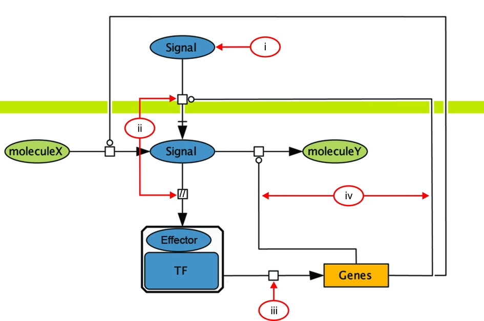

*Figure. GENSOR unit components and their graphical representation.*

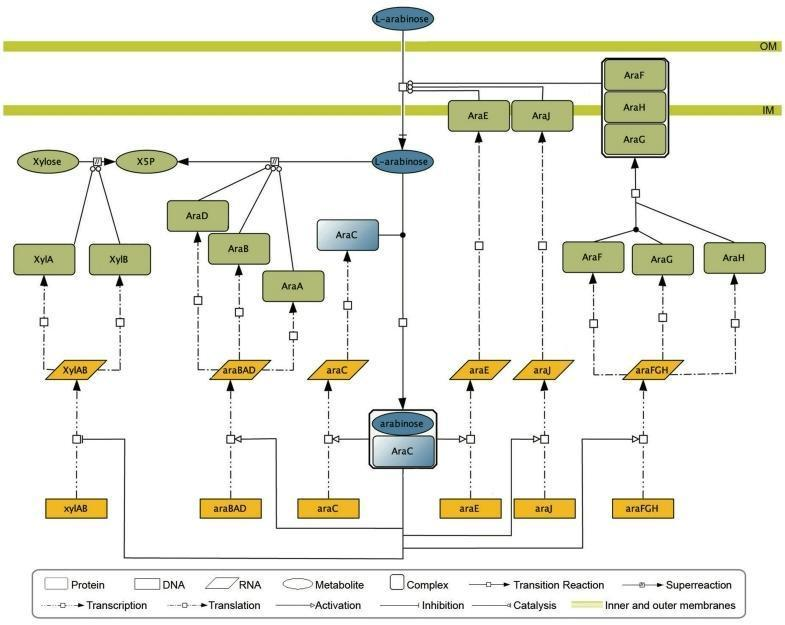

*Figure. The AraC–arabinose GU. In the presence of L-arabinose, AraC activates the transcription of genes for the utilization and transport of L-arabinose; in the absence of glucose, CRP co-regulates with AraC.*

**In RegulonDB.** GUs are derived objects, searchable in the web interface and shown on the GU pages (datamart `gensorUnitDatamart`).

| Property | Description | Example |
|---|---|---|
| Name | GU name, inherited from the name of the regulator | AraC |
| Description | Description of the process, from the signal to the response | |
| Signal | Signal that triggers the processes in the GU | L-arabinose |
| Reactions | Reactions in the GU | |
| Components | Components in the GU | |
| Group | Functional groups to which the GU belongs | Carbohydrate transport and metabolism |

**Example.** The AraC GU (`RDBECOLITFC00220`).

**References.** Gama-Castro S, *et al.* (2011) RegulonDB version 7.0: transcriptional regulation of *Escherichia coli* K-12 integrated within genetic sensory response units (Gensor Units). Nucleic Acids Res 39:D98–D105. PMID: 21051347.

---

# Evidence and Annotation

## Evidence and Confidence Level

**Definitions.**
- An **evidence** is the experimental or computational method that supports a curated object or interaction, with the publication where it was reported. Each evidence type is classified as **strong (S)** or **weak (W)**.
- The **confidence level** of an object is computed from its supporting evidence: **weak (W)**, **strong (S)**, or **confirmed (C)**. **Additive evidence** is the combination of independent evidence types that raises the confidence level, for example to confirmed.

**In RegulonDB.** Collections `evidences` (catalog of evidence types, with `code`, `name`, and `type` S or W) and `additiveEvidences`; objects store their evidence in `citations` (evidence and publication) and their level in `confidenceLevel`.

**Example.** Evidence type `COMP-AINF-SIMILAR-TO-CONSENSUS` (automated inference based on similarity to consensus sequences) is weak.

**References.** Weiss V, *et al.* (2013) Database bas059. https://doi.org/10.1093/database/bas059. Lara P, *et al.* (2024) Front Genet 15:1353553. https://doi.org/10.3389/fgene.2024.1353553

## Position Weight Matrix and Alignment

**Definitions.**
- A **matrix** (weight matrix or position weight matrix, PWM) represents a collection of aligned binding sequences for the same transcriptional regulator. It derives from a multiple alignment of such sites: each row corresponds to one letter of the alphabet (four rows for DNA) and each column to one position within the aligned sites. A frequency matrix contains the frequency of the four nucleotides at each position.
- A **multiple alignment** of the binding sites of a regulatory protein is generated from initially extended binding sites. RegulonDB alignments were generated with the Wconsensus program (Hertz GZ, Comput Appl Biosci 1990;6:81–92) and, more recently, with the MEME suite.

**Acronyms and synonyms.** PWM; PSSM (position-specific scoring matrix).

## Growth Condition

**Definition.** Growth conditions are the experimental conditions in which a strain is grown in a particular experiment performed to study changes in gene expression.

**Description.** The accurate annotation of growth conditions is essential to interpret gene expression data and to compare experiments. RegulonDB uses the Microbial Conditions Ontology (MCO), a controlled vocabulary that defines the minimal elements for reproducible experiments in bacteria: genetic background, culture medium, medium supplements, aeration, temperature, pH, pressure, optical density, growth phase, and growth rate. Not all publications report all these elements.

**In RegulonDB.** MCO terms are in the `terms` and `ontologies` collections. Growth conditions of high-throughput datasets, extracted with natural language processing, are in the HT collection `nlpGrowthConditions`.

<!-- The core collections growthConditionContrasts and growthConditionPhrasesCatalogs have no data yet. -->

**References.** Tierrafría VH, *et al.* (2019) MCO: towards an ontology and unified vocabulary for a framework-based annotation of microbial growth conditions. Bioinformatics 35:856–864. https://doi.org/10.1093/bioinformatics/bty689

---

# Functional Classes

## Expression Machinery Component and Regulator Classes

**Description.** OBAGER classifies material entities from two complementary perspectives: their chemical identity (DNA segment, RNA, protein, or small molecule) and their functional role. Functional classes are inferred from formally defined relationships. (Mejía-Almonte *et al.*, forthcoming)

- An **expression machinery component** is any material entity required for the transcription or translation of a nucleotide segment. It includes cis and trans elements, such as the ribosome, RNA polymerase, promoters, transcription terminators, and ribosome binding sites.
- A **regulator** is an entity observed to influence the activity of another regulator or of an expression machinery component, or to affect the expression of a unit of expression.
- The two classes are intentionally not disjoint: several components of the expression machinery acquired regulatory functions during evolution. For example, σ factors are both essential components of the transcription machinery and regulators of promoter selectivity.

Regulator subclasses are inferred with a few general rules:

1. **Cis-acting and trans-acting regulators.** Regulatory nucleotide segments are cis-acting regulators; gene products and their structural states are trans-acting regulators.
2. **Regulatory stage.** The type of regulatory interaction distinguishes transcriptional from post-transcriptional regulation. Together with rule 1, promoters and transcription factor regulatory sites are cis-acting transcriptional regulators, and RNA regulatory binding sites in the mRNA are cis-acting post-transcriptional regulators.
3. **Inherited regulatory function.** Trans-acting regulators inherit their role by recognizing a regulatory site: TFs, σ factors, and the RNAP holoenzyme are transcriptional regulators through promoter recognition, and small RNAs are post-transcriptional regulators through recognition of their target sites in the mRNA.
4. **Complexes.** Molecular complexes are classified by their participation in regulatory interactions; for example, a protein bound to a DNA site is a biomacromolecular regulator.

**References.** Mejía-Almonte *et al.* (forthcoming).

---

## References

- Mejía-Almonte C, Busby SJW, Wade JT, van Helden J, Arkin AP, Stormo GD, Eilbeck K, Palsson BO, Galagan JE, Collado-Vides J (2020) Redefining fundamental concepts of transcription initiation in bacteria. Nat Rev Genet 21:699–714. PMID: 32665585. https://doi.org/10.1038/s41576-020-0254-8
- Mejía-Almonte C, *et al.* OBAGER: Ontology of Bacterial Gene Regulation (forthcoming).
- Salgado H, *et al.* (2024) RegulonDB v12.0: a comprehensive resource of transcriptional regulation in *E. coli* K-12. Nucleic Acids Res 52(D1):D255–D264. https://doi.org/10.1093/nar/gkad1072
- Gama-Castro S, *et al.* (2011) RegulonDB version 7.0. Nucleic Acids Res 39:D98–D105. PMID: 21051347.
- Maas WK (1964) Studies on the mechanism of repression of arginine biosynthesis in *Escherichia coli*. PMID: 14168690.
- Jacob F (1966) Genetics of the bacterial cell. Science 152:1470–1478.
- Balderas-Martínez YI, *et al.* (2013) Predicted gene control circuits for simple cases. PLoS One. https://doi.org/10.1371/journal.pone.0065723
- Browning DF, Butala M, Busby SJW (2019) Mechanisms of repression and activation by transcription factors at bacterial promoters. J Mol Biol. https://doi.org/10.1016/j.jmb.2019.04.011
- Abril AG, Rama JLR, Sánchez-Pérez A, Villa TG (2020) Role of the σ factor in the transcription process. Appl Microbiol Biotechnol. https://doi.org/10.1007/s00253-020-10577-0
- Weiss V, *et al.* (2013) Evidence classification of high-throughput protocols and confidence integration in RegulonDB. Database bas059. https://doi.org/10.1093/database/bas059
- Lara P, *et al.* (2024) Flexible gold standards for transcription factor regulatory interactions in *Escherichia coli* K-12: architecture of evidence types. Front Genet 15:1353553. https://doi.org/10.3389/fgene.2024.1353553
- Tierrafría VH, *et al.* (2019) MCO: towards an ontology and unified vocabulary for a framework-based annotation of microbial growth conditions. Bioinformatics 35:856–864. https://doi.org/10.1093/bioinformatics/bty689

<!--
Figure sources to review before publication (reuse permissions):
- fig_transcription_initiation.png and fig_tu_operon_schematic.jpg: Mejía-Almonte et al. (2020) Nat Rev Genet (Springer Nature).
- fig_transcription_process.png: Abril et al. (2020) Appl Microbiol Biotechnol (Springer).
- fig_ri_mechanisms.jpg: Browning et al. (2019) J Mol Biol (Elsevier).
- fig_tf_holo_apo.jpg: Balderas-Martínez et al. (2013) PLoS One (CC BY).
- terminator2.png: derived from "Prokaryotic terminators", Wikimedia Commons (check license).
- product.png: source to be confirmed.
- fig_riboswitch_mechanisms.jpg (commented entry): Xu et al. (2023) Synth Syst Biotechnol.
- Figures from the RegulonDB Drawing Traces Tool and RegulonDB diagrams (gene, promoter, terminator, TU, operon, sites, regulators, GENSOR) are RegulonDB's own.
-->

## Related Content

- [Evidence Classification](../evidenceclassification.md)
- [Core Database Collections](../../07_technical_reference/core_collections/README.md)
- [Database Schema Overview](../../07_technical_reference/database_schema_overview.md)

## Last Review

- Last updated: 2026-11-19
- Maintained by: RegulonDB Team
